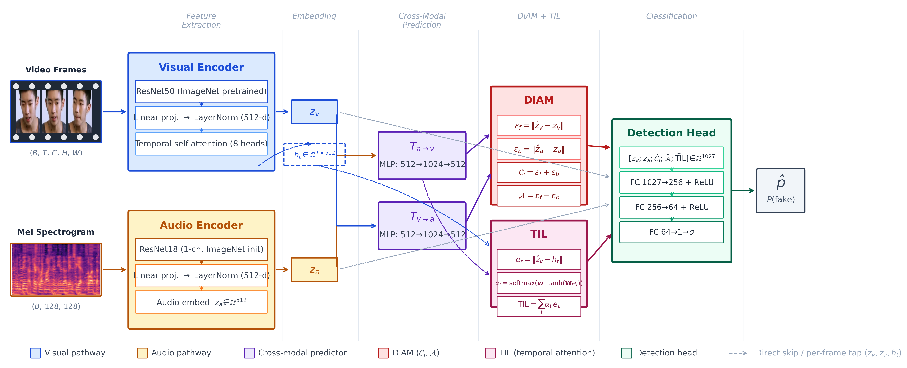
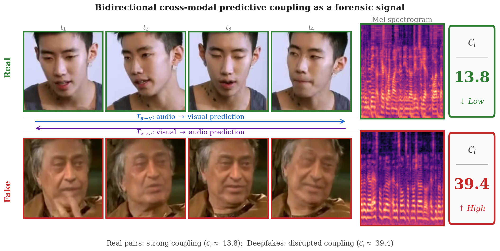

# CMPI: Cross-Modal Predictive Inconsistency for Multimodal Deepfake Detection

<p align="center">
  
</p>

Code for **"Cross-Modal Predictive Inconsistency with Directional Asymmetry Modeling for Multimodal Deepfake Detection"**, *Intelligent Systems with Applications* (accepted 2026).

CMPI trains two lightweight cross-modal predictors, audio→visual (`T_av`) and visual→audio (`T_va`), on **genuine** audio-visual pairs only. A fake clip breaks the coupling between speech and facial motion, so its prediction error is large.

- **CMPI score**: `C_i = ||T_av(z_a) − z_v|| + ||T_va(z_v) − z_a||`
- **DIAM** (Directional Inconsistency Asymmetry Modeling): a signed asymmetry `A = ε_f − ε_b`. Its sign indicates which modality was manipulated (validated in-domain only).
- **TIL** (Temporal Inconsistency Localization): attention over per-frame prediction errors, for partially tampered clips.

The detection head takes `[z_v, z_a, C_i, A, TIL]`. The visual encoder is ResNet-50 with temporal attention and the audio encoder is ResNet-18; both are in `models/`.

## Repository layout

The repository contains two implementations of the same method:

```
models/encoders.py          VisualEncoder (ResNet-50 + temporal attention), AudioEncoder (ResNet-18)
data/dataset.py             FakeAVCeleb DeepfakeDataset + weighted sampler
scripts/                    original research scripts used for the paper
  train_cmpi_diam.py        main model: CMPI + DIAM + TIL (paper results)
  eval_crossdataset_diam.py zero-shot evaluation on LAV-DF / DFDM / Celeb-DF
  preprocess_crossdataset.py  face-crop + mel-spectrogram extraction for cross-dataset benchmarks
  train_cmpi.py, ablation_cmpi.py, cmpi_feasibility.py   original CMPI (C_i-only) model, ablations, feasibility study
  exp_*.py                  diagnostics: renormalisation, CORAL alignment, CORAL calibration-size sweep, bidirectional correlation
  eval_til_partial_tamper.py  TIL vs C_i by LAV-DF tamper-fraction quartile
  eval_gradcam_mouth_stats.py GradCAM++ mouth-region attention statistics
  eval_realforensics_baseline.py, train_realforensics_finetune.py   RealForensics baseline (stage-2 reconstruction)
  sensitivity_analysis.py, extract_analysis.py, extract_frame-spectogram.py
cmpi_modular/               modular re-implementation: one file per component, config-driven
                            training/evaluation pipeline (see cmpi_modular/README.md)
results/                    JSON/CSV outputs behind the numbers reported in the paper
```

<p align="center">
  
</p>

<p align="center"><em>Real audio-visual pairs stay strongly coupled (low C<sub>i</sub>). Deepfakes break the coupling (high C<sub>i</sub>).</em></p>

## Setup

```bash
pip install -r requirements.txt
```

Tested with Python 3.10, PyTorch 2.11 (CUDA 13.0).

## Data

The paper uses public third-party benchmarks; get each from its original source:
FakeAVCeleb (training / in-domain test), LAV-DF, DFDM and Celeb-DF-v2 (zero-shot cross-domain tests).
Put the cross-dataset benchmarks under `datasets/` (or edit the `*_ROOT` constants at the top of `scripts/preprocess_crossdataset.py`).

FakeAVCeleb needs a `metadata.csv` (columns `uid, split, success, label, generator_id`) plus preprocessed arrays `frames/<uid>.npy` (uint8 `[T, H, W, 3]`) and `audio/<uid>.npy` (`[128, 128]` mel), passed in with `--metadata_csv` and `--preprocessed_dir`.

## Usage

```bash
# 1. Train CMPI + DIAM + TIL on FakeAVCeleb (optionally warm-start the encoders from a pretrained checkpoint)
python scripts/train_cmpi_diam.py \
    --metadata_csv <path>/metadata.csv \
    --preprocessed_dir <path>/preprocessed \
    --amdd_checkpoint <path>/full_model_best.pth \
    --output_dir results/diam

# 2. Preprocess a cross-domain dataset
python scripts/preprocess_crossdataset.py --dataset lavdf --output_root data/crossdataset

# 3. Zero-shot cross-dataset evaluation
python scripts/eval_crossdataset_diam.py \
    --checkpoint results/diam/best_model.pt \
    --data_root data/crossdataset \
    --output_dir results/crossdataset_diam
```

Run any script with `--help` to see all options. For the modular pipeline (`python train.py --config ...`), see [`cmpi_modular/README.md`](cmpi_modular/README.md).

## Main results

| Setting | AUROC (%) |
|---|---|
| FakeAVCeleb (in-domain) | 100.00 (BalAcc 98.62) |
| LAV-DF (zero-shot) | 46.30 |
| DFDM (zero-shot) | 56.08 |
| Celeb-DF-v2 (zero-shot) | 64.15 |
| LAV-DF, ImageNet-only encoder init | 56.40 |

Cross-domain generalisation is the main limitation. The paper's diagnostic experiments trace the gap to the encoder's learned representations.

## Citation

```bibtex
@article{ahmad2026cmpi,
  title   = {Cross-Modal Predictive Inconsistency with Directional Asymmetry Modeling for Multimodal Deepfake Detection},
  author  = {Ahmad, Wasim and Zhang, Wei and Saleem, Kiran},
  journal = {Intelligent Systems with Applications},
  year    = {2026},
  note    = {Accepted}
}
```

## License

Released under the [MIT License](LICENSE).
